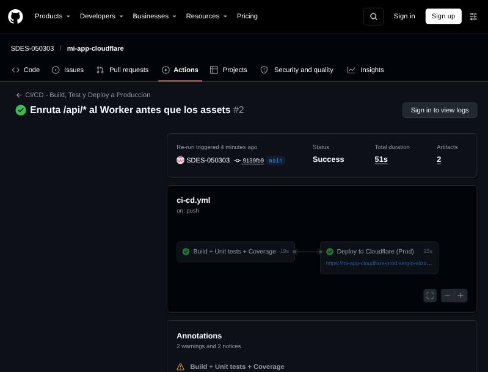
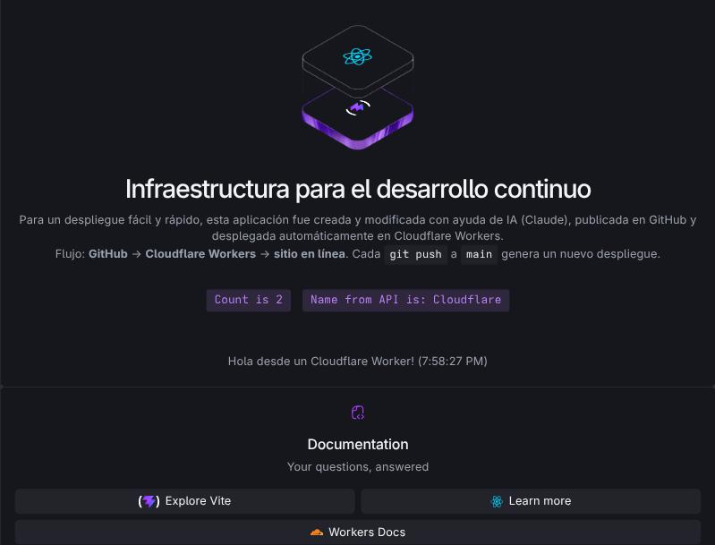
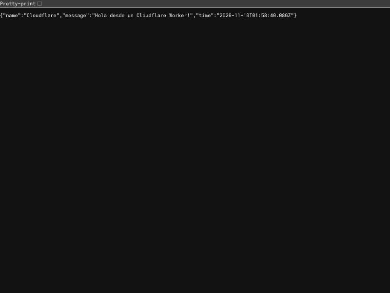
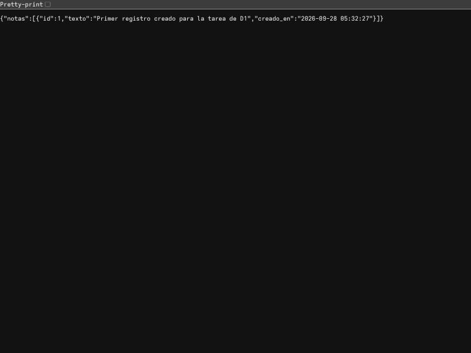

# UAT Report - Práctica 7: Pipeline con UAT

| Campo | Detalle |
| --- | --- |
| Proyecto | Infraestructura para el desarrollo continuo (`mi-app-cloudflare`) |
| Repositorio | https://github.com/SDES-050303/mi-app-cloudflare |
| Responsable | Sergio David Elizondo Silva |
| Fecha de preparación | 2026-10-04 |
| Fecha de ejecución UAT | 2026-11-09 |
| Entorno bajo prueba | Producción (Cloudflare Workers, proyecto `mi-app-cloudflare-prod`) |
| URL de producción | https://mi-app-cloudflare-prod.sergio-elizondo.workers.dev |
| URL de desarrollo | https://mi-app-cloudflare.sergio-elizondo.workers.dev |

> Estado de este documento: completo. Las secciones 2 y 3 contienen resultados de una ejecución local; las secciones 4 y 5 contienen los resultados reales del pipeline en GitHub Actions y de las pruebas de aceptación sobre producción (2026-11-09).

## 1. Alcance

Se agregaron pruebas unitarias con reportes de cobertura al proyecto React + Cloudflare Workers, y un pipeline de GitHub Actions que compila, prueba, publica artefactos y despliega a un proyecto nuevo de Cloudflare (Producción).

Componentes bajo prueba:

- `worker/index.ts`: Worker con las rutas `/api/` (saludo), `/api/db` (lectura de la tabla `notas` en D1) y 404 para cualquier otra ruta.
- `src/App.tsx`: página principal en React (título, mensaje sobre el despliegue con IA, contador y botón que consulta la API).

## 2. Pruebas unitarias

Herramientas: Vitest 5.0.3, React Testing Library, jsdom, `@vitest/coverage-v8`. El Worker se prueba con una base D1 simulada (mock), por lo que las pruebas no requieren credenciales ni red.

Comando: `npm run test:coverage`

| # | Archivo | Prueba | Resultado |
| --- | --- | --- | --- |
| 1 | `src/App.test.tsx` | Muestra el título y el mensaje sobre el despliegue con IA | Pasó |
| 2 | `src/App.test.tsx` | El contador aumenta al hacer clic | Pasó |
| 3 | `src/App.test.tsx` | El botón de la API muestra el nombre y el mensaje del Worker | Pasó |
| 4 | `worker/index.test.ts` | `GET /api/` responde el saludo en JSON | Pasó |
| 5 | `worker/index.test.ts` | `GET /api/db` lee la tabla `notas` de D1 | Pasó |
| 6 | `worker/index.test.ts` | `GET /api/db` con la tabla vacía responde una lista vacía | Pasó |
| 7 | `worker/index.test.ts` | Una ruta desconocida responde 404 | Pasó |

Resumen: 2 archivos de prueba, 7 pruebas, 7 aprobadas, 0 fallidas.

## 3. Cobertura de código

Ejecución local del 2026-10-04 (Node 22). Umbral configurado: 80% en statements, branches, functions y lines; si no se cumple, la prueba falla y el pipeline se detiene.

| Métrica | Cubierto | Porcentaje |
| --- | --- | --- |
| Statements | 17 / 17 | 100% |
| Branches | 6 / 6 | 100% |
| Functions | 7 / 7 | 100% |
| Lines | 16 / 16 | 100% |

Archivos medidos: `src/App.tsx` y `worker/index.ts` (se excluyen `src/main.tsx`, los archivos de prueba y los `.d.ts`). El reporte HTML se genera en `coverage/index.html` y el pipeline lo publica como artefacto `coverage-report`.

## 4. Pipeline (GitHub Actions)

Archivo: `.github/workflows/ci-cd.yml`. Se ejecuta en cada push a `main`, en pull requests (solo el job 1) y de forma manual.

| Job | Pasos | Resultado esperado |
| --- | --- | --- |
| `build-test` | checkout, Node 22, `npm ci`, lint, pruebas con cobertura, resumen de cobertura, subir `coverage-report`, build con `CLOUDFLARE_ENV=production`, subir `dist-production` | Verde; dos artefactos publicados |
| `deploy-prod` (necesita `build-test`) | descargar `dist-production`, `wrangler deploy` al Worker `mi-app-cloudflare-prod`, prueba de humo a `/api/` | Verde; la URL de producción responde |

Secretos requeridos en GitHub (Settings > Secrets and variables > Actions): `CLOUDFLARE_API_TOKEN` y `CLOUDFLARE_ACCOUNT_ID`.

Resultado de la ejecución real:

- [x] Run del workflow: [#2 (intento 2)](https://github.com/SDES-050303/mi-app-cloudflare/actions/runs/42735016614), commit `9139fb9`, duración total 51 s
- [x] Job `build-test`: verde (19 s): lint, 7/7 pruebas, cobertura 100%, build de producción
- [x] Job `deploy-prod`: verde (25 s): despliegue a `mi-app-cloudflare-prod` y prueba de humo a `/api/` aprobada
- [x] Artefactos visibles: `coverage-report` (48 KB), `dist-production` (94 KB)
- Captura: `docs/evidence/pipeline.png`

Incidencia encontrada: las dos primeras ejecuciones fallaron en el paso *Deploy to Cloudflare Workers* porque no existían los secretos `CLOUDFLARE_API_TOKEN` y `CLOUDFLARE_ACCOUNT_ID` en el repositorio. Se creó un API token dedicado para GitHub Actions (plantilla "Edit Cloudflare Workers" + D1 Edit), se registraron ambos secretos y se re-ejecutó el job; pasó en verde.

## 5. Pruebas de aceptación en producción (UAT)

Se ejecutan en el navegador contra la URL de producción, después de un despliegue verde.

| ID | Caso | Pasos | Resultado esperado | Resultado real | Estado |
| --- | --- | --- | --- | --- | --- |
| UAT-01 | La página carga | Abrir la URL de producción | Se ve el título "Infraestructura para el desarrollo continuo" y el mensaje sobre el despliegue con IA | Carga el título y el mensaje sobre el despliegue con IA | Aprobado |
| UAT-02 | El contador funciona | Hacer clic dos veces en "Count is" | El botón muestra "Count is 2" | Muestra "Count is 2" | Aprobado |
| UAT-03 | La API del Worker responde | Abrir `/api/` | JSON con `name: "Cloudflare"`, `message` y `time` | HTTP 200 `application/json`: `{"name":"Cloudflare","message":"Hola desde un Cloudflare Worker!","time":"2026-11-10T01:58:30.479Z"}` | Aprobado |
| UAT-04 | El botón consume la API | Clic en "Name from API is" | El botón muestra "Cloudflare" y aparece el mensaje con la hora | Muestra "Name from API is: Cloudflare" y "Hola desde un Cloudflare Worker! (7:58:27 PM)" | Aprobado |
| UAT-05 | Lectura de D1 | Abrir `/api/db` | JSON `{"notas":[...]}` con el registro de ejemplo | HTTP 200: `{"notas":[{"id":1,"texto":"Primer registro creado para la tarea de D1",...}]}` | Aprobado |
| UAT-06 | Ruta inexistente | Abrir `/no-existe` | La aplicación la maneja como página de una sola vista (SPA); `/api/` y `/api/db` siguen funcionando | HTTP 200 con el `index.html` de la SPA; `/api/` y `/api/db` siguen respondiendo JSON | Aprobado |

Resumen: 6 casos, 6 aprobados, 0 fallidos.

Capturas de evidencia:

| Captura | Archivo |
| --- | --- |
| Pipeline en verde |  |
| Página principal (UAT-01, 02, 04) |  |
| `/api/` (UAT-03) |  |
| `/api/db` (UAT-05) |  |

## 6. Observaciones y riesgos

- El entorno de producción reutiliza la misma base D1 (`mi_app_db`) que desarrollo para no depender de configuración adicional. En un proyecto real convendría una base separada para producción.
- Cloudflare Workers Builds (conectado al repositorio desde el dashboard) sigue desplegando el proyecto de desarrollo `mi-app-cloudflare` en cada push; el pipeline de GitHub Actions despliega solo producción.
- Las pruebas del Worker usan un D1 simulado: validan la lógica y el contrato de las rutas, pero no la conexión real con D1; esa parte se cubre con UAT-05.

## 7. Conclusión

El pipeline compila, ejecuta las pruebas unitarias con cobertura (100%, umbral 80%), publica los artefactos `coverage-report` y `dist-production`, y despliega el artefacto a un proyecto nuevo de Cloudflare (`mi-app-cloudflare-prod`). Los 6 casos de aceptación en producción se aprobaron.

- [x] Aceptado
- [ ] Rechazado

URL del proyecto en producción: https://mi-app-cloudflare-prod.sergio-elizondo.workers.dev
